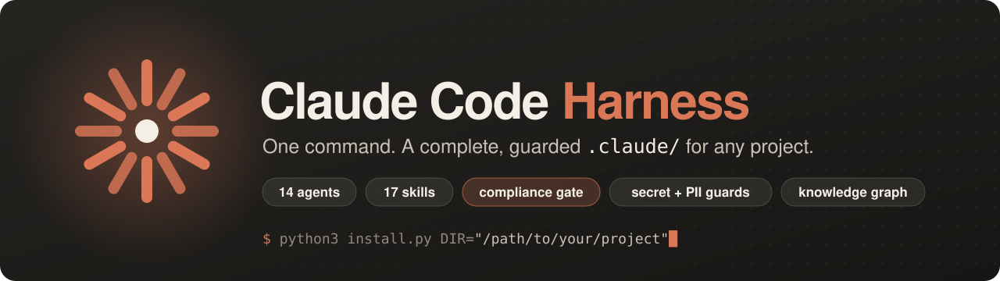

# ❋ Claude Code Harness



[](https://github.com/vaibhavmahna/claude-code/actions/workflows/ci.yml)
[](CHANGELOG.md)
[](#-agents)
[](#-requirements)
[](#-requirements)
[](#-requirements)

**The drop-in operating layer for Claude Code.** One command turns any repository into a governed, multi-agent workspace: model-tiered agents, hook-enforced guardrails, and a compliance gate on every commit.

| | |
|---|---|
| **Agents** | 14 agents on four model tiers: Fable runs the security and compliance reviews, Opus plans, codes and reviews code, Sonnet writes docs, Haiku does lookups |
| **Skills** | 17 skills for design, testing, security, compliance, docs, diagrams and token use |
| **Compliance gate** | GDPR, SOC 2 and health-data rules every agent follows, and no commit until the compliance reviewer passes exactly what is staged |
| **Guards** | Secrets, personal data and dangerous commands (`rm -rf`, force-push, `terraform destroy`) are blocked before they run |
| **Knowledge graph** | An index Claude reads before searching, refreshed in the background |
| **Context budget** | Each agent hands off to a fresh one at 75% of its context |

```bash
git clone https://github.com/vaibhavmahna/claude-code.git ~/claude-code
python3 ~/claude-code/install.py DIR="/path/to/your/project"
```

The installer is plain Python with no dependencies. It merges with any Claude Code setup you already have, and `--uninstall` removes it again.

<!-- toc -->
## 📑 Contents

- [Requirements](#-requirements)
- [Quick start](#-quick-start)
- [What gets installed](#-what-gets-installed)
- [Using it day to day](#-using-it-day-to-day)
- [Agents](#-agents)
- [Skills](#-skills)
- [Security and compliance](#-security-and-compliance)
- [Documentation](#-documentation)
- [Which tools it works with](#-which-tools-it-works-with)
- [Roadmap](#-roadmap)
- [Repo layout](#-repo-layout)
- [Contributing](#-contributing)
- [Security](#-security)

<!-- /toc -->

## 📦 Requirements

- [Claude Code](https://docs.anthropic.com/en/docs/claude-code), tested with 2.1.310
- Python 3.9 or newer, available as `python3`. The installer, hooks and tools use only the standard library: no pip, node or jq.
- macOS or Linux. CI tests both.
- **Windows:** run Claude Code inside [WSL2](https://learn.microsoft.com/windows/wsl/install), a dev container or a Codespace, with the project in the Linux filesystem. On native Windows the PowerShell tool goes through the same command guard and output masking, but the guard reads commands with shell rules, so unusual PowerShell syntax is checked less thoroughly than Bash.
- Git is recommended. The knowledge graph uses commit hashes to spot stale entries, and falls back to file times without it.

## 🚀 Quick start

1. **Get the harness.** Clone it once, anywhere on your machine:

   ```bash
   git clone https://github.com/vaibhavmahna/claude-code.git ~/claude-code
   ```

2. **Preview the install.** This prints every action it would take and changes nothing:

   ```bash
   python3 ~/claude-code/install.py DIR="/path/to/your/project" --dry-run
   ```

3. **Install.** The installer detects your stack, writes `.claude/`, `CLAUDE.md` and `AGENTS.md`, seeds the knowledge graph, and finishes with a self-test of every guard:

   ```bash
   python3 ~/claude-code/install.py DIR="/path/to/your/project"
   ```

   Optional: add `--user-env` so `@file` mentions also pass through the read guard (see [Known limits](docs/security.md#-known-limits)).

4. **Open Claude Code in the project** and check the install:

   ```bash
   cd /path/to/your/project
   claude
   ```

   ```text
   /harness-doctor     checks dependencies, settings, hooks and the knowledge graph
   /kg-bootstrap       builds the knowledge graph out in depth (one time, uses tokens)
   ```

5. **Fill in the project purpose.** Open `CLAUDE.md` and replace the `TODO(human)` line with one paragraph on what the project does and who uses it.

6. **Commit the setup** so your team gets it too:

   ```bash
   git add .claude CLAUDE.md AGENTS.md .gitignore
   git commit -m "chore: add Claude Code Harness"
   ```

   Runtime state, scratch files and hand-off notes are already gitignored.

## 📁 What gets installed

```
your-project/
├── CLAUDE.md                     # harness block between <!-- harness:start/end --> (your content is preserved)
├── AGENTS.md                     # agent roster, routing, protocols (readable by any agent tool)
└── .claude/
    ├── settings.json             # deny/ask/allow rules, hooks, sandbox, status line (merged with yours)
    ├── harness.json              # tunables: context %, compliance gate, scan limits, KG limits
    ├── agents/                   # 14 subagents
    ├── skills/                   # 17 skills (10 knowledge, 6 commands, safe-read)
    ├── hooks/                    # security, compliance-gate, context-budget and knowledge-graph hooks
    ├── tools/                    # kg.py, save.py, safe_read.py, compliance.py, svg_lint.py, doc_format.py, cleanup.py, doctor.py, stack.py, statusline.py
    ├── security/allowlist        # human-only detector exceptions
    └── knowledge/                # INDEX.md → nodes/*.md → exact path:line answers
```

## ⚡ Using it day to day

Work with Claude as usual. The harness shows up in these places:

| You see | What it means |
|---|---|
| Status line `ctx NN%/75%` | How much of the current agent's context is used, and the hand-off limit. |
| `[harness:security] ... blocked` | A guard stopped a secret, PII or a dangerous command. The message names the detector, never the value. |
| `[harness:kg]` | Files the knowledge graph covers changed, so Claude starts knowledge-keeper in the background and carries on. Your reply is not held up. |
| `[compliance gate]` or `[harness:compliance]` | A commit was refused because the compliance reviewer has not passed the staged files, or its verdict was recorded. See [Security and compliance](#-security-and-compliance). |
| `[harness:context] WARN` or `LIMIT` | The agent is near or at its context budget and will hand off. |
| `[harness:cleanup]` | Files that look temporary are left over, and the agent should remove its own. |
| `[harness:docs]` | A Markdown file the agent just wrote is missing the doc format (linked contents, one emoji per heading), and the agent fixes it. |

Commands you can run inside Claude Code:

| Command | Does |
|---|---|
| `/ask-me <question>` | Answers a question about the code cheaply: the Haiku repo-explorer checks the knowledge graph first and replies with `path:line` pointers. The search stays out of your main session's context. |
| `/clean-me-up` | Removes leftovers: temporary files agents made, scratch files, obsolete knowledge-graph nodes, old trash and hand-off notes. Nothing git tracks is touched, and removed files stay restorable. |
| `/harness-doctor` | Health check of the whole install. |
| `/kg-bootstrap` | Builds the knowledge graph in depth. |
| `/handoff` | Writes a hand-off note now, so you can `/clear` and continue fresh. |
| `/resume-handoff <file>` | Continues from a hand-off note. |
| `/safe-read <file>` | Shows a sensitive file with its values masked. |

From a terminal in the project, `python3 .claude/tools/kg.py query <terms>` searches the knowledge graph.

## 🤖 Agents

| Model | Agents |
|---|---|
| **Fable** (security & compliance gates) | security-auditor, compliance-reviewer |
| **Opus** (coding, review & supervision) | orchestrator, coding-agent, frontend-ui-builder, code-reviewer |
| **Sonnet** (docs & diagrams) | doc-writer, doc-reviewer, diagram-builder, diagram-reviewer |
| **Haiku** (basic, cheap) | knowledge-keeper, repo-explorer, commit-helper, lint-fixer |

The aliases `fable`, `opus`, `sonnet` and `haiku` always resolve to the latest model in each tier. The strongest model sits only on the two reviews where a miss costs most: security and compliance. Planning, building and code review run on Opus, writers on Sonnet, and mechanical helpers on Haiku, which keeps everyday cost down. Where Fable is unavailable or overloaded, Claude Code switches the request to Opus on its own (`fallbackModel` in `.claude/settings.json`), and the agents are also told to restart a Fable agent on Opus if it cannot start. A compliance review run on Opus still counts for the gate.

A `[1m]` model suffix for a 1M-token window is accepted but off by default; see [Models](docs/contracts.md#-models).

Pipelines:
- code → code-reviewer (→ security-auditor when the change touches auth, input, data access, crypto, I/O or dependencies) → commit
- docs → doc-reviewer → commit
- diagrams → diagram-reviewer → commit
- commit, every time: commit-helper stages → compliance-reviewer → on `COMPLIANCE: PASS`, commit-helper commits
- knowledge-keeper runs in the background after a change to code or docs
- fast path: a single lookup, or a change in one file under about 20 lines that touches nothing sensitive, is done directly with tests run, no code review. It still needs the compliance review before a commit

See `AGENTS.md` in your project for routing rules.

## 🧩 Skills

| Skill | Purpose |
|---|---|
| `simple-design` | YAGNI, no abstraction with one consumer, standard library before new dependencies, single-purpose changes, small public interfaces (Hyrum's law) |
| `dsa-conscious-coding` | Data-structure choice by access pattern, Big-O notes, worst-case inputs, cache-friendly layouts, performance anti-patterns |
| `diagram-maker` | Mermaid/SVG diagrams built to a precision standard (8px grid, exact alignment, equal spacing, no crossing edges) with one light/dark palette, checked by `svg_lint.py` |
| `token-budget` | KG-first lookups, ranged reads, delegation, terse output |
| `knowledge-graph` | How to query and update the project KG |
| `secure-coding` | OWASP Top 10, input validation, secrets handling, dependencies |
| `data-handling-compliance` | GDPR, SOC 2 and health-data rules for personal data, customer data and AI features, as BLOCK / REQUIRE / FLAG tiers, with one reference file per category and the PR compliance note |
| `test-driven-dev` | Red → green → refactor, hermetic tests, fakes over mocks, equivalence partitioning and boundaries |
| `frontend-a11y-design` | Design tokens, WCAG 2.2 AA, keyboard/focus, responsive, reduced motion |
| `doc-standards` | README / ADR / API / runbook templates; every doc gets a linked table of contents and one emoji per heading, checked by `doc_format.py` |
| `safe-read` | View a sensitive file with values masked |
| `/ask-me`, `/clean-me-up`, `/kg-bootstrap`, `/handoff`, `/resume-handoff`, `/harness-doctor` | User commands |

## 🔒 Security and compliance

Several independent layers enforce the policy, so one gap does not expose everything.

- **Secrets and personal data** are blocked in prompts, file reads, writes, shell commands and web or MCP calls, and masked in tool output. Ordinary project files, such as an author email or local dev credentials, still work.
- **Dangerous commands** are denied: deletes, force-push, `reset --hard`, infrastructure destroys, database drops, and code fetched from the web and run unread.
- **Every commit is gated.** `git commit` is refused until the Fable **compliance-reviewer** has returned `COMPLIANCE: PASS` for exactly the staged files. Editing a file afterwards means a new review. A pull request needs the compliance note in its description.
- **Agents cannot loosen the rules.** Settings, hooks, tools and the gate's state are protected from edits, and `install.py --check` fails in CI if a locked file or rule changed.

Hooks apply to Claude, not to your terminal. Install with `--git-hook` to put commits you type yourself behind the same gate.

Full detail, including every guard, the detection rules, the git policy and the known limits: [docs/security.md](docs/security.md).

## 📚 Documentation

| Page | Covers |
|---|---|
| [docs/security.md](docs/security.md) | Guards, detection rules, git policy, the compliance gate, known limits |
| [docs/configuration.md](docs/configuration.md) | Knowledge graph, context budget, installer options, tunables, upgrade and uninstall, troubleshooting |
| [docs/contracts.md](docs/contracts.md) | Shared conventions: paths, node format, handoff schema, return block, gate protocol, models |
| [evals/README.md](evals/README.md) | Behavioral evals and what they cost |
| [CONTRIBUTING.md](CONTRIBUTING.md) | Setup, tests, and how to add an agent, skill, detector or guard rule |

## 🔌 Which tools it works with

**Any editor.** The harness runs inside Claude Code, which works in the terminal, VS Code, Cursor, Windsurf and JetBrains IDEs, and in the desktop and web apps. Everything below works the same in all of them.

**Other AI agents.** `AGENTS.md` follows the open [AGENTS.md](https://agents.md) convention, so agents that read it (such as Codex, Cursor's agent and GitHub Copilot) follow the same roles, routing, security rules and git policy. What they don't get is enforcement, because hooks and subagents are Claude Code features:

| Feature | Claude Code | Other agents |
|---|---|---|
| Roles, routing, rules and git policy (`AGENTS.md`) | Yes | Yes |
| Secret/PII and dangerous-command blocking | Enforced by hooks | Not enforced: rules only |
| Compliance rules (`AGENTS.md`, `CLAUDE.md`) | Enforced: commits blocked until reviewed | Not enforced: rules only |
| 14 model-tiered agents, 17 skills, `/ask-me`, `/clean-me-up` | Yes | No |
| Knowledge graph | Read and kept up to date | Readable, not updated |
| 75% context hand-off | Yes | No |

Native support for more agents is on the [roadmap](#-roadmap).

## 🎯 Roadmap

- **More AI agents.** Generate each tool's own instruction files (Cursor rules, Copilot instructions, `GEMINI.md`) from the same source, and port the guards to tools that support hooks, with tests per tool.
- **Windows support** and a Windows CI job.
- **Plugin packaging** so the harness can also be installed as a Claude Code plugin, under a name without the reserved `claude-` prefix.

Ideas and votes are welcome in the issues.

## 📂 Repo layout

| Path | Contents |
|---|---|
| `install.py` | The single entry point. |
| `template/` | An exact mirror of what lands in a project: `claude/` becomes `.claude/`, plus `AGENTS.md` and `CLAUDE.md.tmpl`. Edit here to change the harness. |
| `docs/` | `security.md`, `configuration.md`, `contracts.md` (shared conventions), `diagrams/` and `assets/` (the banner). |
| `tests/` | The unit test suite (`python3 -m unittest discover -s tests`). |
| `evals/` | Behavioral evals that run real headless Claude Code sessions and grade them with fixed checks. See [evals/README.md](evals/README.md). |
| `scripts/` | Maintainer scripts, such as `gen_diagram_templates.py`. |
| `.github/` | CI workflow, issue and pull request templates, and Dependabot config. |

## 🙋 Contributing

Contributions are welcome. [CONTRIBUTING.md](CONTRIBUTING.md) covers setup, tests, evals, and how to add an agent, skill, detector or guard rule. Everyone taking part follows the [Code of Conduct](CODE_OF_CONDUCT.md). Release notes are in [CHANGELOG.md](CHANGELOG.md).

## 🛂 Security

Report vulnerabilities privately through the repository's Security tab ("Report a vulnerability"), never in a public issue. [SECURITY.md](SECURITY.md) lists what is in scope and what to include.
